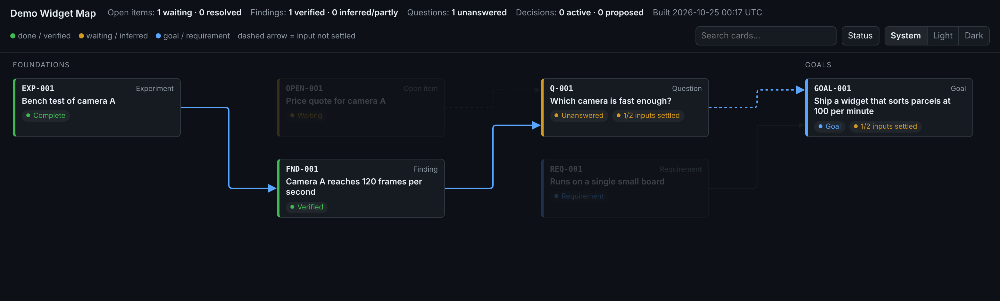

# project-docs

A skill that gives Claude an **ID-based project record**: a small set of interlinked Markdown files in `docs/` that capture why a project is the way it is. The record covers what the project is trying to achieve, what was decided and why, what was tried and what happened, what was learned, and what is still open.

Every entry has a permanent ID (`GOAL-001`, `DEC-007`, `EXP-003`, `FND-012`, `OPEN-004`, …), so people, commits and code comments can cite it, and the record outlives any single chat session. A standing rule in `CLAUDE.md` tells Claude to keep the record current as it works.



## What it includes

- **Typed files with permanent IDs:**

  | File | Prefixes |
  | --- | --- |
  | `goals.md` | `GOAL-`, `REQ-`, `Q-` |
  | `concepts.md` | `CON-` |
  | `decisions.md` | `DEC-` |
  | `experiments.md` | `EXP-` |
  | `findings.md` | `FND-` |
  | `open-items.md` | `OPEN-` |

  The folder also has a `README.md` with Status and History, and an optional Mermaid `dataflow.md`. Entries are superseded, never silently rewritten.
- **`check_docs.py`**, a stdlib-only consistency checker. It reports duplicate IDs, numbering gaps, headings that aren't the bare ID, citations of undefined IDs, and broken links or anchors.
- **`link_symbols.py`**, which links every use of a symbol defined in `concepts.md` back to its definition.
- **`build_dashboard.py`**, which turns the record into a self-contained, offline `dashboard.html`:
  - Each entry is a card, placed left to right by dependency depth (foundations on the left, goals on the right), and colored by status.
  - Cards are joined by orthogonal arrows drawn from each entry's `- **Depends on:**` line. Arrows from the same card share a path until they diverge, paths favor the middle of each gap, and crossings get small hops.
  - Hovering a card highlights its lineage. Clicking one opens a side panel with the full entry and its dependencies.
  - **Focus mode** shows just one or more cards, everything they depend on, and their direct users. Click ◎ on a card, or Shift-click ◎ on several to pick them and then focus on all of them, with an optional "Unsettled only" filter. The focus is kept in the URL.
  - It has search, a status overlay, and System / Light / Dark themes.
- **Obsidian-friendly Markdown.** Each entry is an `<a id>` anchor followed by a heading that is exactly the ID, so links work on GitHub, in VS Code, in MkDocs and in Obsidian.

All scripts use only the Python standard library (3.9+). `scaffold.py` copies them into each project, so collaborators can run them without the skill.

## Install

### Claude Code (plugin marketplace)

```text
/plugin marketplace add mkoistinen/project-docs-skill
/plugin install project-docs@project-docs-skill
```

The skill is then available as `/project-docs:project-docs`, and Claude also uses it on its own when a task calls for it.

### Claude Code (plain skill)

Copy `plugins/project-docs/skills/project-docs/` to `~/.claude/skills/project-docs/` for all your projects, or to `.claude/skills/project-docs/` inside one repository.

### claude.ai

Zip the `plugins/project-docs/skills/project-docs/` folder (the zip should contain the `project-docs/` folder) and upload it as a skill in your claude.ai settings.

## Use

Ask Claude to "set up a project record", "start a decision log", or "get this project organized". Claude runs the scaffold and seeds the record from what it already knows. From then on, it records decisions, experiments, findings and open questions as they happen. After changing the docs, it runs the checker and rebuilds the dashboard.

To do it by hand:

```bash
python3 plugins/project-docs/skills/project-docs/scripts/scaffold.py /path/to/project --project "My Project"
cd /path/to/project
python3 docs/check_docs.py
python3 docs/build_dashboard.py        # writes dashboard.html; add --tz <IANA zone> for the build stamp
```

The scaffold never overwrites existing files, so running it again on an older record only adds what's missing, such as the dashboard builder.

## Repository layout

```text
.claude-plugin/marketplace.json            marketplace catalog (one plugin)
plugins/project-docs/
  .claude-plugin/plugin.json               plugin manifest
  skills/project-docs/
    SKILL.md                               instructions Claude follows
    references/conventions.md              how to write each kind of entry
    assets/templates/                      the docs/ files the scaffold creates
    assets/claude-md-section.md            the standing rule added to CLAUDE.md
    scripts/                               scaffold, checker, symbol linker, dashboard builder
images/                                    README screenshot (synthetic demo data)
```

## License

MIT. See [LICENSE](LICENSE).
