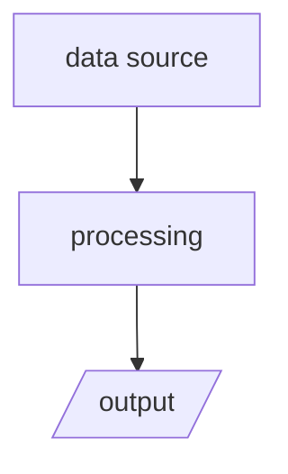

# Dataflow

*Reflects the code as of {{DATE}}. Update this page whenever the pipeline changes.*

Label each node with the IDs it implements (e.g. `(DEC-004)`) so the diagram links back to the record.

## Step by step

1. **Source.**
2. **Processing.**
3. **Output.**
